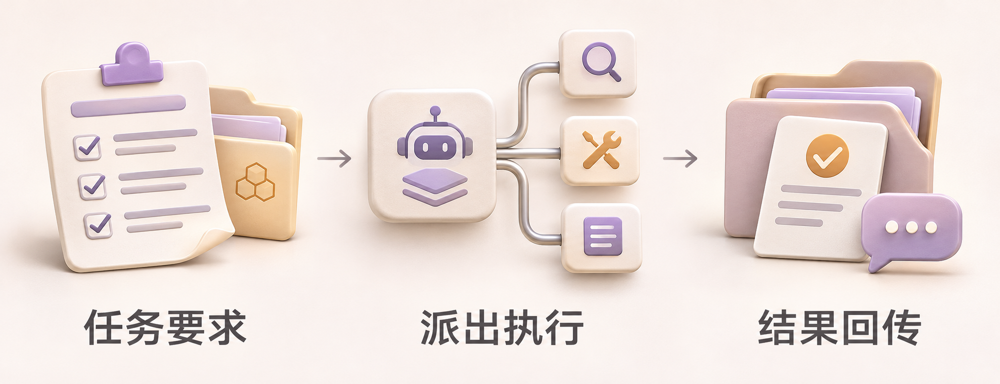
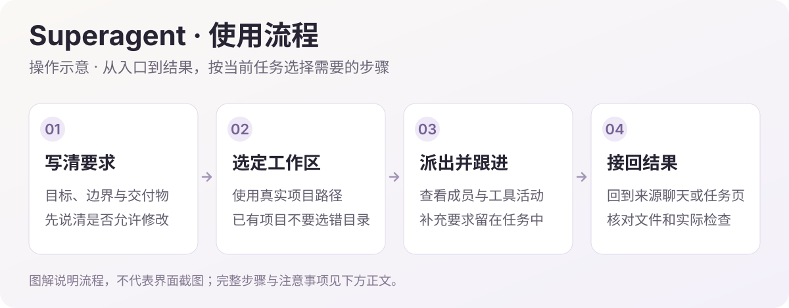

<h1>DSH Superagent · 项目任务</h1>

派出项目任务，回来查看进度、执行过程与结果。

  
  
  

<a href="#功能一览">功能一览</a> · <a href="#快速开始">快速开始</a> · <a href="#visual-guide">图解使用</a> · <a href="#使用场景">使用场景</a> · <a href="#常见问题">常见问题</a> · <a href="#详细文档">详细文档</a>

---

<!-- current-source -->
当前版本：**1.9.9** · [分支 `main`](https://github.com/Missher12/Missher-DSH-Superagent/tree/main) · [Release 与安装包](https://github.com/Missher12/Missher-DSH-Superagent/releases/tag/v1.9.9)。
<!-- /current-source -->

## 功能一览

| 能做什么 | 说明 |
| --- | --- |
| **团队协作工作台** | 团队列表、真实派发与依赖图、成员活动、内嵌会话和交付文件；窄窗口重排。 |
| **明确分工与交付** | 编辑 2–6 名执行成员的分工、模型和交付依赖，协调核对后派发，成员交付后再次复核目标；同目录依次执行。 |
| **真实交付记录** | 只预览实际报告的目录内文件，检查关联真实命令调用并标明成员报告，未验证事项单列。 |
| **MCP 外部派单** | 按应用授权指定工作区，支持本机 stdio 和 Streamable HTTP。 |
| **面板派单** | 写清任务要求，选择真实工作区或项目文件夹。 |
| **聊天派单** | 明确要求交给 Superagent 后，在独立会话中执行。 |
| **跟进任务** | 查看进度、补充要求、重试失败或继续下一步。 |
| **执行约定** | 管理提示词草稿、版本历史与新任务的模型、并发设置。 |

## 快速开始

1. 从 [Releases](https://github.com/Missher12/Missher-DSH-Superagent/releases/tag/v1.9.9) 下载对应版本的 `.tgz` 安装包。
2. 在 DSH **插件 → 添加插件** 中选择下载的文件，安装并启用；按宿主提示重新加载或正常重启。
3. 打开侧栏 **Superagent → 任务 → 新建任务**，或在聊天中明确要求派单。

<!-- visual-guide -->

## 图解使用流程

把目标明确的项目任务派出去，仍能看到过程、继续追问并接回结果。

场景插画：帮助理解用途与操作顺序，不是 DSH 界面截图。

[查看完整流程图](../docs/images/workflow-guide.svg)

| 步骤 | 怎样操作 | 需要留意 |
| --- | --- | --- |
| 1. 写任务 | 在“任务 → 新建任务”填写要求，或在聊天中明确要求交给 Superagent。 | 任务要求说明目标、允许修改的范围和交付物；标题可选。 |
| 2. 选项目 | 处理已有项目时选择对应工作区或真实文件夹。 | 默认独立目录不能替代你要修改的现有项目，派出前核对路径。 |
| 3. 看执行 | 在工作台查看调度与执行成员、工具活动、最近结果，并打开实际会话。 | 需要补充要求时继续跟进；不能只凭活动停止判断任务完成。 |
| 4. 验收结果 | 阅读任务结果、回到来源聊天，并检查生成的文件和验证记录。 | 执行发生在真实项目中；停止任务不会撤销已经写入的文件。 |

### 试一次

> 把这个任务交给 Superagent 后台执行：只读分析当前项目的登录流程，列出入口、关键模块、风险与对应依据。先给结论，不修改文件。

使用后可以这样核对：

- 结果引用了真实项目路径和相关文件。
- 明确区分已做的检查、尚未验证和仍需处理的问题。
- 后续要求被处理后再结束任务；执行会话保留可追溯记录。

### 设置怎么选

| 项目 | 建议 |
| --- | --- |
| 模型与并发 | 按任务选择合适模型；执行中调整模型影响后续请求，不修改全局默认。 |
| 工作台与任务页 | 工作台观察成员活动，任务页保留要求、跟进与结果；必要时打开真实会话。 |
| 外部 MCP | 本机 stdio 与 Streamable HTTP 按应用授权工作区；连接步骤见项目 MCP 教程。 |

本地派单需要 DSH 保持运行并有可用模型，不强制配置 GitHub、飞书或额外 CLI。外部接入请看 [MCP 接入教程](../docs/mcp.md)，不要将示例任务文字当作 MCP 请求参数。
<!-- /visual-guide -->

## 使用前了解

- 任务直接在所选项目中工作，停止任务不会撤销已经写入的文件。
- 提交、推送、发布和创建子代理仍需要明确要求，执行权限沿用宿主约定。

<!-- readme-expansion -->
## 使用场景

| 遇到的情况 | 怎样使用 |
| --- | --- |
| 想把一个明确的项目任务交给独立会话完成 | 选择真实工作区，写清目标、约束和完成条件，再从任务页跟进结果。 |
| 需要在继续自己工作的同时观察执行进度 | 工作台显示调度、执行成员、实际工具活动和最近结果，可打开真实会话查看细节。 |
| 希望外部应用也能派发限定范围内的任务 | 通过 MCP 连接授予指定工作区，按应用分别管理令牌与访问范围。 |

## 常见问题

安装后必须先配 GitHub 或飞书吗？

本地派单不需要这些外部账号。GitHub、飞书属于可选来源，默认不启用；外部应用可按 MCP 教程单独连接。

关闭 DSH 后，后台任务会继续跑吗？

不会。DSH 需要保持运行；任务记录会保留，重启后的恢复以任务状态和回执为准。手动停止的任务不会自动恢复。

停止任务会撤销已经写入的文件吗？

不会。任务使用所选的真实项目目录，停止只是结束后续执行；已经产生的修改和结果需要正常检查、保留或另行撤销。

模型、并发和权限如何决定？

默认使用 DSH 模型，插件设置可调整后续新任务的模型与并发。同一项目的任务依次执行；新建任务可选择 DSH 权限，默认跟随 DSH，团队成员继承任务权限；聊天派单继承来源会话权限。

## 搭配使用

[Focus](https://github.com/Missher12/Missher-DSH-Focus) 提供任务方法与执行提醒，[工作仪表盘](https://github.com/Missher12/Missher-DSH-Dashboard) 汇总任务概览；Superagent 负责派单、执行会话和结果回传。

## 升级与数据

调度数据与实际项目文件分开保存。升级沿用原数据目录和插件实例，等待当前任务结束后按宿主提示加载更新；更新完成应同时确认任务页和运行中的主组件。
<!-- /readme-expansion -->

## 详细文档

[项目原说明](../README.md) · [本地模式与扩展](../docs/local-mode.md) · [MCP 接入教程](../docs/mcp.md) · [许可证](../LICENSE)

原有功能细节、配置、截图与验证记录保留在上述文档中，历史结论按其注明的版本理解。
