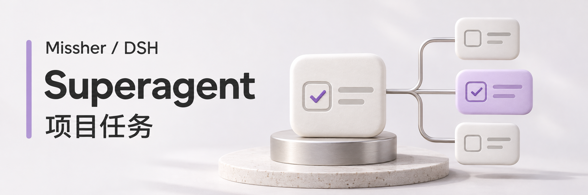

# Missher DSH Superagent

当前版本 **1.8.1** · [下载安装包](https://github.com/Missher12/Missher-DSH-Superagent/releases/tag/v1.8.1)
在 DSH 里派出任务，在 Superagent 的独立工作区中查看执行会话、文件目录、进度和结果。

适用场景：调研代码、定位问题、修改功能、运行相关检查。任务会在自动创建的独立目录或你选择的已有项目目录内工作，遵守该项目的 `AGENTS.md`。

## 安装

要求：DeepSeek Harness `0.2.1-rc.4` 或 `0.2.2-rc.1`，已配置可用模型。

1. 在 DSH「插件 → 添加插件 → 安装第三方插件」填入本地 `.tgz` 的绝对路径。
2. 安装完成后点击「立即启用」。
3. 打开侧栏 **Superagent**。首次使用无需配置 GitHub、飞书或额外 CLI。

本地开发升级保留原组合包和配置：先用 DSH 自带 CLI 执行 `dsh plugin --profile desktop add /安装包的绝对路径.tgz`，再到「插件 → Superagent → 包含的组件」，关闭并重新启用主组件 **Superagent**。只替换安装包可能让界面和仍在运行的后端版本不同；重新启用主组件后再确认任务页正常。任务数据保存在当前 DSH 数据目录下的 `superagent-local`，更新插件不会主动清理任务记录。

## 怎么用

**团队工作台**：左侧切换任务，中间查看成员原生会话，右侧查看协作关系、成员分工及完成条件。支持多任务、添加成员、关闭单个或全部工作区；关闭视图会保留任务和文件。卡片之间的光点沿真实交接路径流动。窄窗口自动重排。

会话标题右侧的“上下文”直接打开当前成员的上下文管理插件页面；单成员会话也有对应标签，可查看插件原有的容量构成、变化及整理记录。工作台隐藏滚动条，保留滚轮、触控板和键盘滚动。

**团队派单**：工作台点击“新建任务”，选择“团队协作”，填写目标、目录及 2–6 名执行成员的分工、模型和等待交付关系。协调成员先核对，成员按依赖交付，最后回到协调会话复核目标。同一目录依次执行；规划回合结束不等于团队完成。成员默认继承团队模型。

**真实交付**：文件预览只开放该团队实际报告的目录内文件；检查记录关联本轮真实命令调用，结果明确标为成员报告，未运行或未验证事项单独列出。原始会话和工具记录始终可查。补充要求持久化投递给选中的成员，未读要求阻止旧一轮提前完成；前置成员更新后，下游重新复核并再次汇总。

**面板派单**：在「任务」页点击「新建任务」，写清要求，默认创建独立目录；需要修改已有项目时切换到“现有项目”，选择工作区或填写路径，然后点击「派出任务」。标题可以留空；切换页面会保留尚未发出的草稿。

**聊天派单**：在项目的普通 DSH 会话里直接说：

> 把这个任务交给 Superagent 后台执行：分析当前项目的登录流程，指出可能的问题，先给结论，不修改文件。

聊天工具仅在你明确要求派单时使用，结果会回到来源会话。普通聊天和开发请求仍由当前会话处理。

**模型选择**：新建任务弹窗可指定模型与思考强度；工作台选中成员后，原生输入框内可以切换模型与思考强度，运行中在下一步请求生效。选择只影响该任务或会话，保留 DSH 的全局默认模型。

**任务目录**：新任务默认在 Superagent 工作区中按标题创建独立文件夹（默认 `~/.dsh/superagent-local/work/task-标题-短标识`）；也可切换为“现有项目”，沿用所选目录。执行环境设置中的任务目录可改变工作区根目录。

**跟进任务**：打开任务即可查看最新结果和执行过程。进行中可补充要求，失败后可重试；已完成的任务可填写下一步要求继续执行。手动停止的任务不会自动恢复，“重新派单”会先生成供你检查的草稿。

**任务记录**：详情中的“任务记录”保留派单依据、策略版本、每次派工、恢复原因和输入送达状态，完整执行步骤仍在对应会话中查看。看板把等待后续触发的任务与需要人工处理的任务分开，等待分区在没有任务时自动隐藏。

**页面切换**：任务、工作区和设置使用相同的紧凑导航，正文在页内滚动。切回工作台会回到先前选中的任务和成员；关闭全部工作区后保持空白。工作区可按名称或路径搜索，长路径收在单行中，悬停可查看完整路径。

**执行约定**：设置采用分组导航，选择“提示词”进入独立编辑区；MCP、外部来源及规则也有各自入口。正文、完整预览和版本历史在区域内部滚动，保存栏保留在正文下方；返回设置会保留未保存草稿。修改保存后生效，恢复默认沿用当前本地模式的约定。

**紧凑管理页**：任务、工作区与设置共用 980px 的内容宽度及统一字号。任务以列表显示，可按状态筛选，空分组在“全部”中隐藏，保留分页和完整记录。工作区的打开、派单和移除在行尾，窄窗口保留有名称的图标操作。

**插件联动**：成员会话沿用 DSH 原有的会话增强设置。Project Ops 的诊断、能力搜索、项目任务列表、方案与交付读取四项只读工具可供执行成员使用，沿用已有任务权限；写入、另行执行等工具继续关闭。插件配置在 DSH 原有插件管理中维护。

## 工作区与文件位置

在 Superagent「工作区」页查看真实项目路径，使用「添加工作区」选择已有文件夹；点击「派任务」会带入该目录并保留未发送的草稿。任务详情可以打开原生 DSH 工作区和执行会话，会话右上角的「用访达打开」可定位实际文件。独立任务的文件位于各自子目录；现有项目任务直接在所选项目中执行。默认的 `~/.dsh/superagent-local` 是调度数据目录。

行尾“移除工作区”需要确认，只注销 DSH 工作区注册，保留磁盘文件、会话与任务历史，以后可重新添加目录。任务根工作区、还有未完成或正在运行任务的工作区不能移除。

## 默认行为

- 默认同时执行一个任务。同一项目的任务始终依次执行。
- 使用 DSH 默认模型；可以在插件「设置」中为之后新建的任务选择模型和并发数。
- 聊天派单继承来源会话的具名权限，面板派单使用 DSH 默认权限；插件不会自行扩权。
- 提交、推送、发布和创建子代理都需要你明确要求。
- DSH 关闭后任务不会继续运行；记录会保留，未完成的执行会在重启后恢复。
- 独立任务自动新建空目录；现有项目任务不会自动复制项目；停止也不会撤销已经写入的文件。

「帮助」页提供简要使用步骤和聊天派单示例。

## 外部应用派单

在 **设置 → MCP 外部派单** 新建连接、勾选工作区，复制配置到目标应用。支持本机 stdio 和 Streamable HTTP，可派单、读取进度和结果、补充要求、停止及失败重试。令牌和工作区授权按应用隔离，DSH 需保持运行。详见 [MCP 接入教程](docs/mcp.md)。

GitHub 和飞书提供可选来源组件：启用后，在「设置 → GitHub 与飞书」配置账号 CLI 和已有工作区，再设置接收范围及授权规则。默认不启用，连接校验失败会明确显示原因，本地与 MCP 任务仍可使用。真实接入验收状态见 [完成记录](docs/completion-plan.md)。

适配方式和运行边界见 [本地模式及扩展说明](docs/local-mode.md)。源码中的编号文档和 SETUP.md 介绍上游引擎与独立 GitHub 部署，本地插件日常使用无需执行这些部署步骤。

## 开发

Node 24，`pnpm install` 后运行 `pnpm check`；用 `pnpm pack --pack-destination dist` 生成安装包。原生加载需要用目标 DSH 宿主另行验证，不能只以标准 Node 构建成功作为依据。

## 来源与许可

基于 [DeepSeek Harness 团队的 MIT 研究原型](https://github.com/deepseek-ai/dsh-superagent-prototype) 适配。本项目并非 DeepSeek 官方产品，保留上游代码与 [MIT 许可证](LICENSE)。
